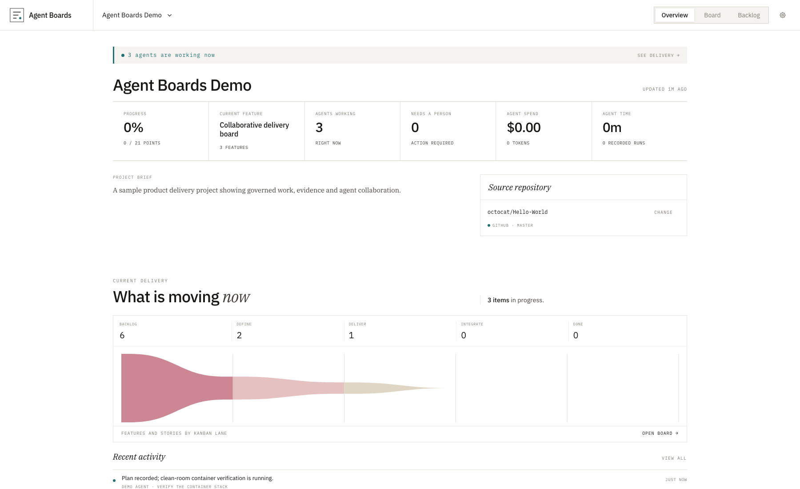
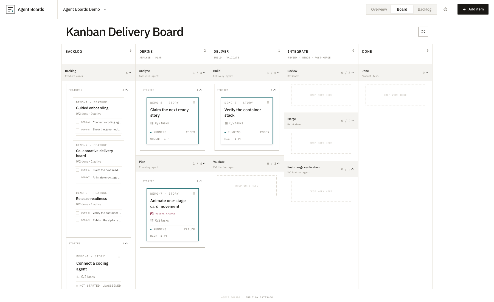

# Agent Boards

Agent Boards is a shared, governed project record for people and AI coding
agents. Projects own one delivery board; features contain stories, stories
contain tasks, and deterministic evidence gates control progression. Codex,
Claude Code, the web UI, and REST clients use the same durable record.

The `v0.1.0-alpha.1` release is for trusted local or self-hosted use. It is not yet
an authenticated multi-tenant service and must not be exposed directly to the
public Internet.

## See Agent Boards in action

The overview keeps project health, active delivery, recent activity, and the
source repository in one durable project record.



The delivery board groups the governed workflow into five action lanes while
preserving the finer-grained evidence gates underneath.



## Quick start with Docker

Requirement: Docker Compose v2.

```bash
cp .env.example .env
docker compose up --build -d --wait
```

Open <http://127.0.0.1:4173>. The OpenResty gateway exposes the UI, REST API,
MCP Streamable HTTP endpoint, repository intelligence, and managed evidence
uploads on one local origin. A fresh installation includes the Agent Boards
Demo project shown above; it is created only when the database contains no
projects. Stop the stack with `docker compose down`.

Useful documentation:

- [Introducing Agent Boards](docs/introducing-agent-boards.md)
- [Architecture](docs/architecture.md)
- [Docker and Apple Container build recipes](docs/container-recipes.md)
- [Development and release checks](docs/development.md)
- [Security assurance](docs/security-assurance.md)
- [Release certification checklist](docs/certification/release-checklist.md)
- [Claude Code setup](docs/clients/claude-code.md)
- [Open-source readiness and remaining blockers](docs/open-source-readiness.md)
- [Contributing](CONTRIBUTING.md) and [security policy](SECURITY.md)

## License

Agent Boards is licensed under the [Apache License 2.0](LICENSE). Copyright
2026 Datashow Pty Ltd. See [NOTICE](NOTICE) for attribution information.

## Run on Apple Container

Requirements: macOS with the Apple `container` CLI.

```bash
./scripts/stack.sh up
```

Open <http://localhost:4173>. The same gateway exposes:

- PostgREST: <http://localhost:4173/api/>
- MCP (Streamable HTTP): <http://localhost:4173/mcp>
- MCP health: <http://localhost:4173/mcp/health>
- Repository intelligence: <http://localhost:4173/intelligence/>

Use `AGENT_BOARDS_PORT=8080 ./scripts/stack.sh up` to choose another host port.

```bash
./scripts/stack.sh status
./scripts/stack.sh logs
./scripts/stack.sh down
```

`down` removes the six containers but preserves PostgreSQL data and
repository mirrors in named volumes.

## Stack

| Service | Purpose |
| --- | --- |
| `agent-boards-db` | PostgreSQL 17, schema, RPCs, seed board, telemetry views |
| `agent-boards-rest` | PostgREST over the `api` schema |
| `agent-boards-repo-intelligence` | Read-only exact-revision repository indexing, search, syntax graph, quality definitions, and cited maps |
| `agent-boards-mcp` | Stateless Streamable HTTP MCP tools backed by PostgREST |
| `agent-boards-web` | Production-built React Router + Mantine SPA with self-hosted IBM Plex fonts |
| `agent-boards-gateway` | OpenResty gateway for the UI, REST API, MCP streaming, and evidence media |

The web app and MCP server deliberately use the same PostgREST surface. There
is no second agent-only plan or hidden task store.

The visible Kanban groups the governed stages into five action lanes:
**Backlog**, **Define** (Analyse + Plan), **Deliver** (Build + Validate),
**Integrate** (Review + Merge + Post-merge verification), and **Done**. The
overview delivery summary consumes the same shared lane definition as the
board, while the database keeps the finer-grained evidence gates.

The first browser connection opens a short, dismissible overview of the
project record, governed stages, agent loop, and evidence model. It can be
replayed from Project settings. Settings are project-scoped: maintainers can
group adjacent governed stages into named board buckets and edit their purpose,
responsible actor, WIP limit, and deterministic exit criteria. Stage identity,
order, and allowed transitions remain database-protected and are not editable
presentation preferences.

Projects can be archived and restored through the UI, REST RPCs, or MCP.
Archived projects leave the active portfolio and selector but keep their board,
project record, activity, and repository intelligence. Their work queue is
read-only and cannot return claimable work until restored.

Board movement is governed in PostgreSQL. Every update to `stage_id`, including
a direct PostgREST patch, must follow the current stage's allowed transitions:
Backlog → Analyse → Plan → Build → Validate → Review → Merge → Post-merge
verification → Done. The MCP
server tells agents to move the shared card as each stage's work is completed;
the database rejects skipped stages, and Done is terminal.

Prerequisites are also database-governed. An autonomous worker calls
`claim_next_ready_work_item`, which atomically selects and claims the oldest
highest-priority eligible story and returns a focused work package: the story,
its child tasks, invariants, deterministic acceptance contract, and the current
promotion checklist. Dependency data is used to establish eligibility but is
not repeated in the claimed package once it has been satisfied. A story
cannot run while any prerequisite is incomplete, and it cannot move to Done
while any child task remains incomplete.
After taking the story through the governed stages, the worker calls the same
tool again. If the story cannot progress, it records the reason with
`block_work_item` and immediately asks for the next ready item. The loop stops
when `claim_next_ready_work_item` returns `no_ready_work`.

Several Codex, Claude, or other MCP clients can work the same project at once.
Give each worker a stable, unique name and let each run the same claim loop.
Claims use row locking with `SKIP LOCKED`, so concurrent workers receive
different ready stories instead of racing for the same card. `owner` is the
durable person or agent accountable for an item; `assignee` is the transient
worker holding its current claim and is cleared when that claim is released or
blocked. The queue prefers work already owned by the requesting worker, then
unowned work, and assigns durable ownership on the first claim. Every move is
still emitted as an individual board event, so independently progressing cards
use the existing one-card movement animation without refreshing the board.

Stage progression is evidence-gated for stories. Analyse must produce analysis
evidence, Plan must produce an implementation plan, Build must identify the
implemented revision, and Validate must record passing tests for that revision.
The promotion payload calls these checks the current stage's acceptance
criteria. Review requires approval of the accepted revision with no unresolved
findings. Merge then requires that exact approved revision to be integrated.
Post-merge verification requires target-branch checks or an explicit waiver
before Done. Unit and regression testing are project quality constraints rather
than universal assumptions: they start as recommendations, become blocking
when an agent or person records a deterministic required check, and can be
waived only with an explicit user decision and durable rationale. These checks
live in PostgreSQL and therefore apply to both MCP operations and direct
PostgREST updates.

Stories must be created with deterministic acceptance criteria. Each criterion
contains a concrete pass condition, a verification method, a test/command/
endpoint/query/baseline reference, and an exact expected result. The worker
records each result against an exact revision; Review is rejected until every
criterion passes for the same revision.

Visual work is governed only when a feature or story is explicitly marked as a
visual change (`visual_evidence_required`). Stories inherit the marker from
their parent feature. Unmarked work does not require image or video evidence.

Material UI interaction is governed separately with
`interaction_evidence_required`. These stories cannot move from Validate to
Review until the exact accepted revision has a human-approved walkthrough.
The recording must be a continuous 1× capture lasting at least eight seconds,
show a pointer or touch indicator, and carry at least two timestamped actions
with deterministic expected results spaced far enough apart to inspect. The
MCP upload probes the actual media duration; flash-cut montages, accelerated
route cycling, state slideshows, unreviewed recordings, and agent self-approval
do not satisfy the gate.

New applications and material redesigns follow a design track inside Analyse
and Plan. A `visual_concept` design card must present at least two distinct
options for human selection. The selected direction is then documented and
approved in the stable `design-concept` artefact, followed by an approved
`design_system` / `style-guide` artefact defining colour, typography, spacing,
components and states, interaction or motion, responsive behaviour, and
accessibility. Visual stories declare exact screen/state/viewport targets;
each target needs a human-approved mockup attached to the story or a shared
`screen_mockup` design card. Agents can author options and artefacts but cannot
self-approve them. PostgreSQL rejects Plan → Build until the full design
contract is complete.

Design-only cards do not enter the software implementation pipeline. A
`visual_concept` or `screen_mockup` card progresses through Backlog → Analyse →
Plan, then closes directly to Done once its tasks and governed human approvals
are complete. Agent Boards records a durable `design-contract:*` revision for
that approved contract without fabricating implementation, test, review, merge,
or regression evidence. Implementation stories that consume the approved
assets continue through the full software pipeline.

Build still requires an implementation screenshot for the exact revision
before Validate, and Validate requires visual validation or a visual diff for
the accepted revision before Review. The focused MCP work package includes the
assets, design governance and promotion checks without relying on chat context.

Agent Boards remains the control plane for this workflow. It does not generate
the application, drive a browser, or perform visual inspection on behalf of an
agent. Instead, the MCP server distributes portable visual implementation and
visual validation skill contracts as MCP resources and through
`get_service_capability`. Visual work packages advertise the applicable
contracts in `service_capabilities`. A connected Codex, Claude, or other agent
uses its own native coding, browser, image, recording, and testing capabilities,
then records durable evidence through Agent Boards. PostgreSQL remains
authoritative for approvals, exact-revision evidence, invariants, and promotion
gates. No separately installed local Agent Boards skill or product-design plugin
is required to discover the procedure.

For hosts that provide the Product Design workflows, Agent Boards exposes
`get_mockup_implementation_package` with the `product-design:image-to-code`
route and `get_visual_critique_package` / `record_visual_critique` with the
`product-design:design-qa` route. These tools resolve approved static inputs,
exact screen/state/viewport and revision bindings, measurement requirements,
and evidence destinations. Critique results are durable measured records;
unresolved or out-of-tolerance P0/P1/P2 values keep promotion blocked.

## MCP tools

- `list_projects`
- `list_service_capabilities`
- `get_service_capability`
- `create_project`
- `archive_project`
- `restore_project`
- `get_project_repository`
- `set_project_repository`
- `remove_project_repository`
- `request_repository_index`
- `get_repository_index_job`
- `get_repository_snapshot`
- `search_repository`
- `read_repository_file`
- `list_repository_symbols`
- `get_repository_graph`
- `compare_repository_revisions`
- `get_repository_quality_checks`
- `list_repository_maps`
- `upsert_repository_map`
- `get_board`
- `update_board_stage_settings`
- `create_backlog_item`
- `move_work_item`
- `update_work_item`
- `set_work_item_prerequisites`
- `set_acceptance_criteria`
- `set_work_item_invariants`
- `list_ready_stories`
- `list_project_quality_constraints`
- `set_project_quality_constraint`
- `claim_next_ready_work_item`
- `get_work_item_context`
- `get_design_card_completion_requirements`
- `complete_design_card`
- `get_mockup_implementation_package`
- `get_visual_critique_package`
- `record_visual_critique`
- `claim_work_item`
- `block_work_item`
- `release_work_item`
- `list_work_item_evidence`
- `list_work_item_assets`
- `list_visual_design_validations`
- `record_visual_design_validation`
- `set_application_design_scope`
- `get_project_design_governance`
- `approve_visual_concept`
- `approve_design_artefact`
- `approve_screen_mockup`
- `attach_work_item_asset`
- `attach_validation_recording`

Validation media is uploaded to Agent Boards-managed storage through
`POST /uploads` (raw file body with `Content-Type` and `X-File-Name` headers),
then attached to the exact revision and evidence record. `GET /uploads/<id>`
serves the uploaded file with range support for embedded playback. The web UI
performs this upload automatically; the MCP recording tool accepts the captured
file bytes as base64 and stores the file before creating the evidence attachment.
- `set_primary_work_item_asset`
- `delete_work_item_asset`
- `list_work_item_activity`
- `list_work_item_comments`
- `add_work_item_comment`
- `record_work_item_evidence`
- `record_acceptance_result`
- `list_project_records`
- `get_project_record`
- `upsert_project_record`
- `record_telemetry`

The REST equivalents are `GET /api/project_quality_constraints` and
`POST /api/rpc/set_project_quality_constraint`. A waiver is not a silent skip:
it requires a reason and records the deciding actor in project activity.

Board configuration is exposed through
`POST /api/rpc/update_board_stage_settings`. The RPC accepts a stage ID, bucket
title, purpose, responsible actor, optional WIP limit, exit-criteria array, and
actor name. It records the change in project activity without exposing stage
order or transition mutation.

Design-only completion is exposed through
`POST /api/rpc/design_card_completion_requirements` and
`POST /api/rpc/complete_design_card`. Both use `target_work_item_id`; the
completion call also accepts `actor_name`.

Visual REST endpoints are `GET /api/work_item_assets`,
`POST /api/rpc/attach_work_item_asset`,
`POST /api/rpc/set_design_card`,
`POST /api/rpc/set_work_item_asset_screen`,
`POST /api/rpc/approve_visual_concept`,
`POST /api/rpc/approve_design_concept`,
`POST /api/rpc/approve_style_guide`,
`POST /api/rpc/approve_screen_mockup`,
`POST /api/rpc/set_primary_work_item_asset`, and
`POST /api/rpc/delete_work_item_asset`.

## Source repository API

Projects link to a persisted source repository record rather than presentation
text. The overview, REST clients, and MCP work packages all read this same
association.

- `GET /api/project_repositories?project_id=eq.<project-id>` — read the linked repository
- `POST /api/rpc/set_project_repository` — link or change the repository and default branch
- `POST /api/rpc/remove_project_repository` — unlink a repository

Repository intelligence is served below `/intelligence/v1`. Indexing is
read-only and revision-pinned. Declarations and import/export edges are marked
with `precision: syntax`; they are deterministic parser facts, not
compiler-resolved call graphs. Discovered quality commands are definitions,
not passing results—the agent or CI still executes them and records evidence.

- `POST /intelligence/v1/index` — queue an index for a project/revision
- `GET /intelligence/v1/jobs/<job-id>` — poll the durable job
- `GET /intelligence/v1/projects/<project-id>/snapshot` — resolve a ready snapshot
- `POST /intelligence/v1/search` — search an exact snapshot
- `GET /intelligence/v1/snapshots/<snapshot-id>/symbols` — list syntax declarations
- `GET /intelligence/v1/snapshots/<snapshot-id>/graph` — list import/export edges
- `GET /intelligence/v1/snapshots/<snapshot-id>/quality-checks` — list configured checks
- `POST /intelligence/v1/compare` — compare resolved revisions
- `GET|PUT /intelligence/v1/projects/<project-id>/maps[/<map-key>]` — read or persist cited maps

For private GitHub repositories, export `GITHUB_TOKEN` before starting the
Apple Container or Docker Compose stack.
The stack forwards it only to the repository-intelligence container and Git
uses a host-scoped request header; credentials are never embedded in the
persisted repository URL.

Project lifecycle REST RPCs are:

- `POST /api/rpc/archive_project`
- `POST /api/rpc/restore_project`

## Project record API

Project briefs, PRDs, architecture documents, design concepts, design systems,
risk registers, and issue registers share the `project_artifacts` resource.
Agents and people read the same versioned records through PostgREST or the MCP
tools above.

- `GET /api/project_artifacts?project_id=eq.<project-id>` — list records
- `GET /api/project_artifacts?project_id=eq.<project-id>&artifact_key=eq.<key>` — read one record
- `POST /api/rpc/upsert_project_artifact` — create or version a record
- `PATCH /api/project_artifacts?id=eq.<record-id>` — update through PostgREST

## Multi-worker ownership API

- `POST /api/rpc/set_work_item_owner` — assign or clear durable ownership
- `GET /api/project_owner_summary?project_id=eq.<project-id>` — owner workload counts
- `POST /api/rpc/claim_next_work_package` — atomically claim one distinct ready story
- MCP `set_work_item_owner` and `list_project_owners` expose the same ownership model

Multiple workers are supported by the local trusted stack. This is concurrency,
not tenant security: authentication, project-scoped authorization, and hosted
multi-tenant isolation remain future production boundaries.

## Development checks

```bash
pnpm release:check
pnpm security:licenses
pnpm security:oss    # after `aqua install`
pnpm test:live       # with the stack running
pnpm test:claude     # with authenticated Claude Code
```

The current stack is a local-development foundation. PostgREST uses an
anonymous role with full project CRUD so local people and agents can collaborate
without setup; authentication, tenant isolation, and project-scoped MCP tokens
are the next production boundary.
