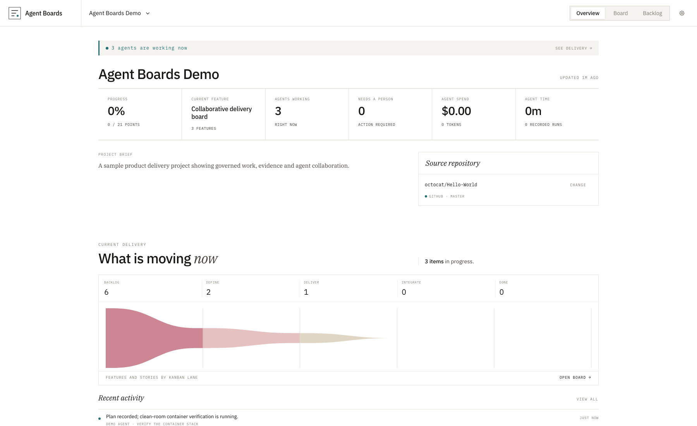
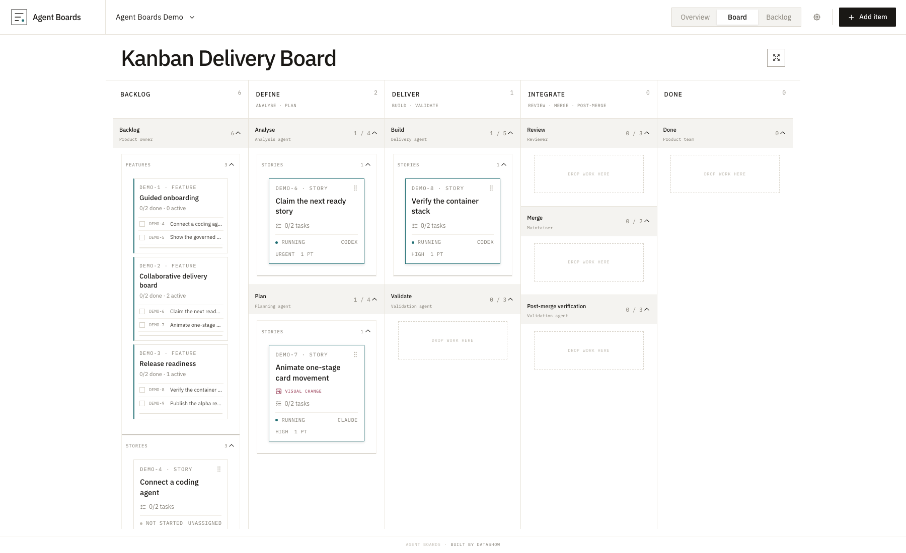

# From `backlog.md` to Agent Boards: a governed delivery loop for coding agents

AI coding agents are very good at completing a well-defined piece of work. The
harder problem begins when we ask them to keep going.

A common solution is a `backlog.md` file. Write down a list of tasks, tell the
agent to choose the next unfinished item, implement it, mark it complete, and
repeat until it cannot make further progress. This is a surprisingly useful
pattern. It gives a long-running agent direction, reduces repeated prompting,
and leaves behind a simple record of what has been attempted.

But it is also deliberately simple. A Markdown checklist does not know whether
a task is actually ready. It cannot atomically stop two agents from claiming
the same work. It does not require analysis before implementation, bind test
results to the revision that was reviewed, or prove that the reviewed code was
the code that was merged. As a project grows, the file becomes a mixture of
plan, status report, scratchpad and historical record—and the process depends
on every agent interpreting the instructions in the same way every time.

That is why we created **Agent Boards**.

Agent Boards keeps the productive backlog loop, but puts it inside a shared,
governed software delivery process. Agents connect through MCP. People use the
web interface. REST clients use the same underlying API. Everyone reads and
updates one durable project record, while PostgreSQL enforces the transitions,
dependencies and evidence requirements that matter.

## The useful idea inside `backlog.md`

The basic autonomous loop is sound:

1. Find the next open item that has no incomplete prerequisites.
2. Claim it so another worker does not duplicate the effort.
3. Read the focused requirements.
4. Perform the work.
5. Record the result, or record why the work is blocked.
6. Ask for the next eligible item.
7. Stop when there is no ready work.

Agent Boards makes that loop explicit through
`claim_next_ready_work_item`. Before entering the loop, a Codex, Claude, or
other MCP client registers a project-scoped persistent handle and retains its
immutable worker ID and private resume token. Registration also records only
the capabilities actually available to that session. Those credentials accompany each
claim-sensitive operation, so a display-name collision cannot let one agent
operate another agent's claim. The claim operation is atomic: it selects and claims
the oldest, highest-priority eligible story. It returns a focused work package,
not the whole project. That package contains the story, its child tasks,
invariants, deterministic acceptance criteria and the promotion criteria for
the current stage.

When the story reaches Done, the agent asks for another. If it cannot progress,
it records a concrete reason with `block_work_item` and continues with the next
ready story. When no work is eligible, the service returns `no_ready_work` and
the loop ends.

Several registered workers can run this loop simultaneously. PostgreSQL gives
each one distinct, compatible ready work. A story inherits explicit capability
requirements from its feature and tasks; an incompatible worker does not see
it as claimable and receives `no_compatible_work` when that is all that remains.
Agent Boards does not assume every Codex can generate images or that no Claude
can: workers advertise the tools available in their actual session. Agent Boards records the public handle,
client type, last-seen time, claim ownership, and audit history. Resume tokens
are never returned by worker listings or written into board records.

The board remains the project record. The connected agent remains responsible
for coding, testing, browser operation, design and other execution work.

## A software delivery process, not a larger checklist

Agent Boards does not let a card jump from “to do” to “done.” Software stories
move one legal stage at a time:

**Backlog → Analyse → Plan → Build → Validate → Review → Merge → Post-merge verification → Done**

For readability, the Kanban groups those gates into five action-oriented lanes:

- **Backlog** — unclaimed work.
- **Define** — Analyse and Plan.
- **Deliver** — Build and Validate.
- **Integrate** — Review, Merge and Post-merge verification.
- **Done** — accepted, merged and verified work.

The compact board gives a human an immediate view of the project. Underneath,
the finer-grained stages preserve the delivery controls and audit history. A
project can customise how adjacent stages are grouped and describe each lane's
purpose, responsible actor, WIP limit and exit criteria, but it cannot reorder
or bypass the protected workflow.

## Promotion is earned with evidence

Every forward transition has promotion criteria. These are not suggestions
hidden in an agent prompt; they are database-enforced invariants that apply to
MCP operations and direct REST updates alike.

- **Analyse** records the understood scope, dependencies, risks and invariants.
- **Plan** records the implementation and verification approach.
- **Build** identifies the exact implemented source revision.
- **Validate** records passing results for that same revision.
- **Review** approves the accepted revision and requires no unresolved findings.
- **Merge** proves that the exact approved revision was integrated.
- **Post-merge verification** records target-branch regression checks, or an
  explicit waiver and alternative check.
- **Done** requires all child tasks and the complete evidence chain to reconcile.

The database rejects skipped stages. It also rejects a Review promotion until
every deterministic acceptance criterion has passed against one exact
revision. A merge record must refer back to the reviewed revision. Evidence
cannot quietly drift between different versions of the code.

Not every repository begins with unit or regression tests. Agent Boards treats
quality checks as project constraints rather than pretending they always
exist. An agent can recommend and establish a check. Once recorded as required,
it becomes a gate. A person can waive it, but the waiver requires a named actor
and durable rationale; it is not a silent skip.

## Better stories for agents

An autonomous worker does not need a vast project dump. It needs a precise
story with enough context to act safely.

Agent Boards therefore separates:

- the focused story and its required tasks;
- prerequisites, which determine whether the story is eligible;
- invariants that must remain true;
- deterministic acceptance criteria;
- the current stage's promotion requirements; and
- the service capabilities needed to complete specialised work.

Acceptance criteria describe a concrete pass condition, how it will be
verified, the relevant command, endpoint, query or visual baseline, and the
exact expected result. This makes the work package portable between Codex,
Claude Code and other MCP-capable agents without relying on the memory of a
particular chat.

## Humans can see what the agents are doing

Autonomy without visibility is difficult to trust. Agent Boards provides a
shared interface for both the current state and the history that produced it.

People can see:

- which agents are active and which stories they have claimed;
- features, stories and child-task completion;
- prerequisites and blocked work;
- every governed stage transition;
- analysis, plans, implementation, test, review, merge and regression evidence;
- progress comments, decisions and clarification requests;
- attached images, videos and exact-revision proof; and
- project artefacts such as the brief, PRD, architecture, design system, risks
  and issues.

Cards move from discrete events rather than whole-board refreshes, so a viewer
can follow work as it progresses. The complete activity stream remains
available when the live moment has passed.

## Visual delivery is part of the SDLC

Visual work needs more than a screenshot added at the end. When a feature or
story is marked as visual, Agent Boards introduces a governed design contract.

New applications and material redesigns begin with alternative visual concepts
for a person to select. The accepted direction becomes a versioned design
concept, followed by an approved design system or style guide. Visual stories
declare their screens, important states and target viewports. Each target needs
an approved mockup before implementation can progress.

Agents may create the options and artefacts, but they cannot approve their own
work. Design-only concept and mockup cards close after their governed human
approvals without being forced through fictional code, test and merge steps.
Implementation stories continue through the complete software pipeline.

For implemented interfaces, Agent Boards can bind the approved mockup, rendered
screen and measurement results to an exact revision. Material fidelity failures
and unresolved high-priority findings block promotion. Stories with meaningful
interaction can additionally require a real-time validation recording with a
visible pointer or touch indicator and deliberate, timestamped actions. A
rapid montage of screens is not accepted as interaction evidence, and a human
must approve the walkthrough.

The service provides the contracts and gates. The connected agent uses its own
native image generation, browser, recording, coding and testing capabilities to
perform the work and upload the resulting evidence.

## One record for the whole project

The backlog is only one part of delivery. Agent Boards also maintains versioned
project records for briefs, requirements, architecture, design concepts, design
systems, risk registers and issue registers. These records are available to
agents through MCP and REST, and to people through the web application.

Projects can link a real source repository. A dedicated read-only repository
intelligence service indexes exact revisions, exposes file and symbol search,
maps syntax-level imports and exports, discovers configured quality checks and
stores cited repository maps. This gives agents useful code context without
confusing a discovered test command with evidence that the test has passed.

The result is a more complete project memory: what we intended to build, why we
made key decisions, what is currently in flight, what evidence supports each
promotion, and what risks or issues remain open.

## Designed for more than one kind of agent

Agent Boards exposes standard Streamable HTTP MCP. Its worker contract and
specialised capability instructions are discoverable from the service, rather
than depending on a separately installed local skill. Codex, Claude Code and
other compatible clients can therefore use the same tools and encounter the
same database gates.

The browser, MCP server and REST clients all use the same PostgREST surface.
There is no private agent-only backlog and no second version of the plan. The
same card a person sees is the card an agent claims and updates.

## An open foundation for governed agent delivery

Agent Boards is open source under the Apache License 2.0. The alpha release is
intended for trusted local or self-hosted use and ships with a demo project so
the workflow can be explored immediately. It includes Docker Compose and Apple
Container recipes behind a single OpenResty gateway.

The current release is deliberately not an Internet-facing multi-tenant
service: authentication, tenant isolation and project-scoped agent credentials
remain future work. That boundary is explicit because governance should apply
to the delivery platform itself, not only to the projects recorded inside it.

`backlog.md` showed us the value of a simple autonomous loop. Agent Boards keeps
that loop, then adds what sustained software delivery needs: dependency-aware
selection, atomic claims, deterministic acceptance criteria, promotion gates,
exact-revision evidence, human authority, a complete audit trail and a shared
view of the work.

It gives agents a process they can follow every time—and gives the rest of us a
way to see, understand and govern what they are doing.

